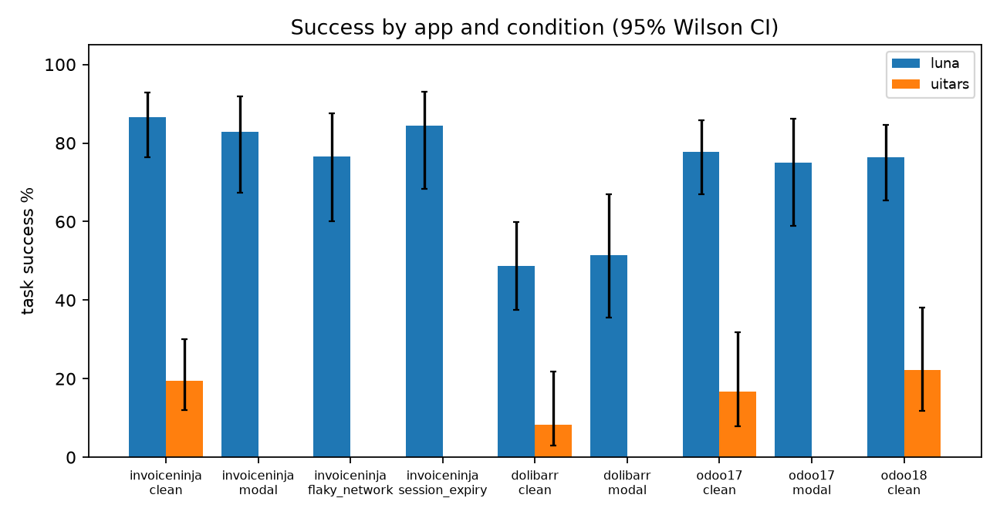

# software-world-model

**A benchmark that checks what a computer-use agent actually did to the database, not what it said it did.**

[](https://github.com/shubhamjoshipromail-svg/software-world-model/actions/workflows/tests.yml)
[](LICENSE)


Agents drive real, self-hosted business apps (Invoice Ninja, Dolibarr, Odoo 17, Odoo 18) in a browser. Every
episode starts from the same database snapshot, and afterwards the **whole database is diffed**. That gives four
verdicts per episode instead of one:

| Verdict | Meaning |
|---|---|
| **Success** | the task's target state is in the database |
| **Collateral damage** | something changed that the task did not require |
| **Irreversible change** | a deletion, un-reconciliation or state change on a record the task never named |
| **False completion** | the agent said "done" and the database says no |



## What we found (Phase 0, 635 scored episodes)

1. **A version upgrade broke things quietly.** From Odoo 17 to Odoo 18, task success held (78% → 76%), but
   collateral damage rose from 15% to 21% and irreversible changes from 6% to 10%. Odoo 18 locks fields on posted
   invoices, so to edit a reference the agent clicks *Reset to Draft*, which **silently un-reconciles the
   customer's payment**. It then re-posts the invoice and reports success.
2. **Success rates hide damage.** "Clean success" (task done and nothing else touched) is up to 12 points lower
   than raw success on Odoo.
3. **Composition collapsed.** Single-step skills reach up to 100%. A 3-step task (find the oldest unpaid invoice,
   pay it, report the new balance) succeeded **0 of 50** times across 4 apps and 2 agents (0 of 66 counting
   perturbed runs).
4. **A small world model survives a version upgrade but not a new app.** A latent dynamics model trained on
   label-free exploration predicts state transitions within an app and from Odoo 17 to 18, and does not transfer
   across apps at this scale.

Agents: GPT-6 Luna (accessibility tree + screenshot) and UI-TARS-1.5-7B (screenshot only), same harness, 30-step
budget. Full write-up with every table, the failure taxonomy and the limitations:
**[reports/phase0_writeup.md](reports/phase0_writeup.md)**.

> These are small-sample results from one person's Phase 0: 36 to 72 episodes per cell, one run per task, Wilson
> 95% intervals. Read [Limitations](#limitations) before quoting a number.

## Quickstart

You need Docker, Python 3.10 to 3.12 (or [uv](https://docs.astral.sh/uv/), which fetches one for you), and about
8 GB of free disk.

```bash
git clone https://github.com/shubhamjoshipromail-svg/software-world-model.git
cd software-world-model
make install          # virtualenv, package, Chromium
make test             # 18 unit tests, no Docker or API key needed
```

**Check the published numbers without running anything** (rebuilds every table from the committed episode
summaries: 635 scored, plus 35 superseded ones kept for a sensitivity check):

```bash
make report
```

**Run an agent yourself.** Start one app, then run one task per skill:

```bash
cp .env.example .env            # add OPENAI_API_KEY (or OPENAI_BASE_URL for a local model)
.venv/bin/swm doctor            # checks Docker, browser, key, disk
.venv/bin/swm up odoo17         # creates local credentials, starts Odoo, seeds 60 clients and 250 invoices
.venv/bin/swm run --app odoo17 --per-skill 1 --tag smoke/odoo17/clean
.venv/bin/swm report            # tables and figure from your own runs/
```

`swm up` takes about six minutes the first time (image download and seeding). In Phase 0, GPT-6 Luna cost one
to three cents per successful task. Each episode writes screenshots, the step log and a `summary.json` under `runs/<tag>/<task>/`.

Apps: `invoiceninja` · `dolibarr` · `odoo17` · `odoo18`. Everything binds to `127.0.0.1`, agents cannot navigate
off localhost, and no real email can be sent.

## Bring your own agent

Three ways, from least to most work:

```bash
# 1. Any chat model on the OpenAI API
swm run --app odoo17 --model <model-name> --tag mymodel/odoo17/clean

# 2. Any OpenAI-compatible server (vLLM, Ollama, OpenRouter, LiteLLM): set OPENAI_BASE_URL in .env
swm run --app odoo17 --model qwen3-vl --tag qwen/odoo17/clean

# 3. Your own class
swm run --app odoo17 --model custom:my_pkg.my_agent:MyAgent --tag mine/odoo17/clean
```

A custom agent is one class with one method. It returns a [BrowserGym](https://github.com/ServiceNow/BrowserGym)
action string:

```python
class MyAgent:
    tok_in = tok_out = 0                      # token counters, reported per episode

    def __init__(self, actions, app): ...     # actions.describe() lists the action space

    def act(self, goal, obs, axtree_text, jpeg_bytes):
        return "click('42')", "raw model output", {}

    def cost(self):
        return 0.0                            # dollars so far
```

Details and a worked example: [docs/ADDING_AN_AGENT.md](docs/ADDING_AN_AGENT.md).

## What is measured

- **9 skills × 8 instances = 72 tasks per app**: find a record, count, cross-record total, create client, create
  invoice, edit a field, bulk status change, record a payment, and a 3-step composite. Tasks are written in each
  app's own vocabulary and generated deterministically from the seed data.
- **One synthetic company in every app**, from one generator: 60 clients (about 15% near-duplicate names such as
  "Dunder Health Ltd" and "Dunder Health Limited"), 250 invoices in mixed states, about 109 payments.
- **Perturbations** (`--perturb`): a blocking "What's new" modal, a flaky network (1 to 4 s latency, 8% HTTP 500),
  and session expiry mid-task.
- **Per episode**: success, collateral damage, irreversible changes, false completion, gave up or timed out,
  steps, tokens, dollars, wall time.

The diff lives in [`swm/dbdiff.py`](swm/dbdiff.py) (about 90 lines, MySQL and Postgres). What counts as a
legitimate change for each task is in `swm/tasks_*.py`.

## Results

Clean condition. Full table with perturbations and per-skill breakdown:
[reports/phase0_results.md](reports/phase0_results.md).

| Model | App | n | Success [95% CI] | Clean success | Collateral | Irreversible | False completion |
|---|---|---|---|---|---|---|---|
| Luna | Invoice Ninja | 67 | 87% [76–93] | 87% | 0% | 0% | 6% |
| Luna | Dolibarr | 72 | 49% [37–60] | 44% | 6% | 0% | 18% |
| Luna | Odoo 17 | 72 | 78% [67–86] | 68% | 15% | 6% | 6% |
| Luna | Odoo 18 | 72 | 76% [65–85] | 64% | 21% | 10% | 6% |
| UI-TARS-7B | Invoice Ninja | 72 | 19% [12–30] | 18% | 14% | 3% | 26% |
| UI-TARS-7B | Dolibarr | 36 | 8% [3–22] | 8% | 0% | 0% | 22% |
| UI-TARS-7B | Odoo 17 | 36 | 17% [8–32] | 14% | 19% | 11% | 17% |
| UI-TARS-7B | Odoo 18 | 36 | 22% [12–38] | 19% | 31% | 8% | 22% |

Neither agent was trained on any of these apps, so this table measures app difficulty, not transfer.

## Repository layout

```
swm/            harness, agents, database diff, per-app tasks and verifiers, report
  apps/         one adapter per app (login, snapshot, restore, capture)
envs/           docker compose files and credential templates, images pinned by digest
results/        phase0_episodes.jsonl: one line per published episode
reports/        write-up, result tables, failure taxonomy, world-model probe
tests/          unit tests, including one that rebuilds the published table
docs/           adding an agent, adding an app
colab/          serving UI-TARS-1.5-7B with vLLM on a Colab GPU
```

## Limitations

- **Small samples, one run per task.** Intervals are wide; several differences between cells are inside them.
- **Collateral whitelists are hand-built per app.** App-generated noise (sessions, counters, wizards) is
  whitelisted by inspection and listed in code. A different whitelist would move collateral rates by a few
  points. The reset-to-draft case does not depend on it.
- **The diff copies every table**, which is fine at this data size and would not scale to a large database.
- **A harness bug was found and fixed mid-run.** 12 Invoice Ninja episodes could not be rerun and are excluded;
  counting them as failures is reported alongside.
- **Developed on macOS.** The unit tests run on Linux in CI; the full harness has not been run on Linux.
- **Raw step logs and screenshots are not in the repo** (about 800 MB). The per-episode summaries are.

The write-up's [limitations section](reports/phase0_writeup.md#7-limitations-honest-list) is longer and more
specific.

## Related work

State-based grading of agents is an active area. [Agent-Diff](https://arxiv.org/abs/2602.11224) diffs full
environment state for API agents on Slack, Linear, Box and Calendar replicas.
[EntWorld](https://www.alphaxiv.org/abs/2601.17722) verifies enterprise GUI agents by querying Odoo and EspoCRM
databases. [WebArena](https://webarena.dev) and [WorkArena](https://github.com/ServiceNow/WorkArena) are the
standard web-agent benchmarks, and this harness is built on [BrowserGym](https://github.com/ServiceNow/BrowserGym).
What this repo adds is the same tasks across **two major versions of one app**, with collateral and irreversible
changes reported separately from success.

## Contributing

New apps, agents and verifier fixes are welcome: see [CONTRIBUTING.md](CONTRIBUTING.md). The most useful
contribution is a result on a model we have not run; open a pull request with your `results` JSONL.

## Citing

```bibtex
@misc{joshi2026softwareworldmodel,
  author = {Joshi, Shubham},
  title  = {software-world-model: do computer-use agents transfer to business software they have never seen?},
  year   = {2026},
  url    = {https://github.com/shubhamjoshipromail-svg/software-world-model}
}
```

## License

MIT for the code in this repository: see [LICENSE](LICENSE). The apps are pulled as their publishers' Docker
images and keep their own licenses; none of their code or data is redistributed here.
